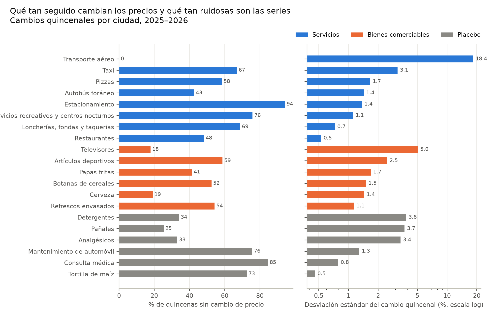
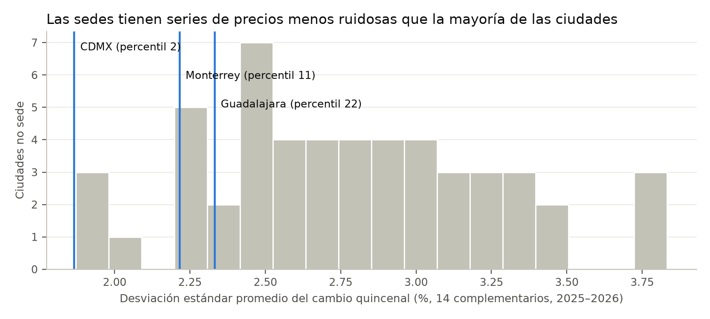
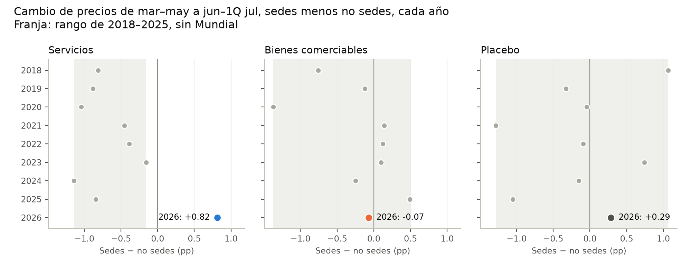
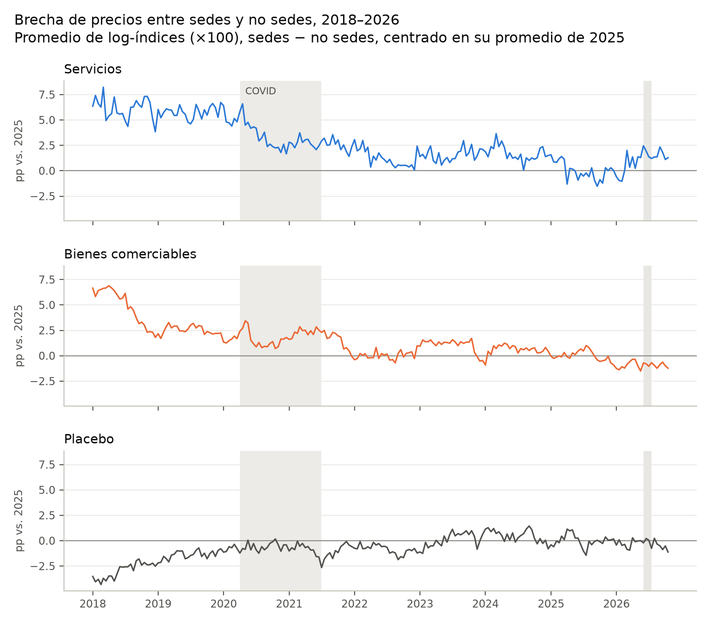

# Análisis exploratorio de la base (INPC por ciudad)

Las cifras y gráficas salen de `code/03b_eda.py`. Para regenerarlas:

```bash
.venv/bin/python code/03b_eda.py
```

## Respuesta corta

**Sí, la base cumple** para nuestra métrica ("precios y/o venta de productos
complementarios al futbol, sin hospedaje") y para el diseño de diferencia en
diferencias:

- Trae precios de los genéricos complementarios en las 3 sedes y en 52 ciudades de control.
- No hay huecos en la ventana de estimación (2025–2026).
- Tiene 8 años de historia para pruebas placebo.
- Es pública, oficial y replicable sin token.

**No trae ventas.** La consigna dice "y/o", así que con precios basta.

**Pendientes:**
1. Ponderadores del INPC, para traducir el efecto a gasto de los hogares.
2. Decidir si agregamos más genéricos complementarios que ya están descargados.

## 1. Lo que pide la consigna, punto por punto

| Requisito | ¿Cumple? | Detalle |
|---|---|---|
| Métrica: precios de complementarios, sin hospedaje | Sí | 14 genéricos complementarios. Hoteles y paquetes turísticos están excluidos. |
| (b) Quién recaba los datos | Sí | INEGI, con precios de una muestra fija de establecimientos en cada ciudad. |
| (b) Periodo | Sí | Descargamos de la 1Q ene 2018 a la 2Q oct 2026 (212 quincenas). INEGI tiene algunas series desde 1995. |
| (b) Unidad de observación | Sí | Índice de precios de un genérico en una ciudad en una quincena. |
| (b) Población | Sí | Consumo de los hogares urbanos de las 55 ciudades del INPC. Los ponderadores de la actualización 2024 vienen de la ENIGH. |
| (b) Virtudes y limitaciones | Sí | Secciones 3 a 6. |
| Grupo tratado y de control | Sí | 3 sedes y 52 ciudades no sede, todas con los 20 genéricos de análisis. |
| Periodos antes, durante y después | Sí | En la ventana 2025–2026 hay 34 quincenas antes, 3 durante y 7 después. |
| Material para robustez | Sí | 8 años sin Mundial (placebo por año), 6 genéricos placebo, ciudades vecinas y fronterizas que se pueden excluir. |
| Material para heterogeneidad | Sí | Servicios vs. bienes comerciables, por sede y por genérico. |
| Base de datos en el repositorio | Sí | Crudos 12 MB, limpios 58 MB. Ningún archivo pasa el límite de 100 MB de GitHub. |
| README con fuente, enlace y cómo descargar | Sí | Ya está en el README. |

## 2. Cobertura

- **Panel completo:** 3,216,805 observaciones (55 ciudades × 292 genéricos × 212 quincenas).
- **Celdas sin dato o en cero en los CSV de INEGI:**
  - 5.2% vienen como "N/E" (sin dato).
  - 0.4% vienen en cero. INEGI pone 0 cuando el genérico no existe en esa ciudad, por ejemplo metro en ciudades sin metro. Se eliminan en la limpieza.
- **Los 20 genéricos de análisis** están en las 55 ciudades, y desde 2025 no falta ninguna celda. El panel está balanceado y por eso la permutación de sedes puede ser exacta.
- **Excepciones antes de la ventana:**
  - 9 ciudades entran al INPC hasta la 2Q jul 2018: Atlacomulco, Cancún, Coatzacoalcos, Esperanza, Izúcar de Matamoros, Pachuca, Saltillo, Tuxtla Gutiérrez y Zacatecas.
  - "Servicios recreativos y centros nocturnos" empieza en la 2Q jul 2024 (es nuevo en la canasta 2024).
  - "Botanas de cereales" empieza en la 2Q jul 2018.
- **Cambio de canasta (2Q jul 2024):** no deja un salto visible en las series. Las quincenas con los cambios más grandes son las de diciembre y enero (ajustes anuales de precios).
- Tabla completa: [`output/tables/eda_cobertura.csv`](../output/tables/eda_cobertura.csv)

## 3. Cómo se mueven los precios



Cambios quincenales por ciudad, 2025–2026. Tabla: [`eda_cambios_quincenales.csv`](../output/tables/eda_cambios_quincenales.csv).

- **Muchos servicios casi no cambian de precio:**
  - Estacionamiento no cambia en 94% de las quincenas, centros nocturnos en 76%, loncherías en 69% y taxi en 67%.
  - Si el Mundial los movió, el efecto aparece como un escalón que se queda, no como un pico que regresa. Por eso el modelo separa "durante" y "después".
- **Transporte aéreo es casi puro ruido quincenal:**
  - Desviación estándar de 18%; la mitad de las quincenas cambia más de 10% y hay saltos de hasta 92%.
  - Las peores series son de ciudades sin aeropuerto propio, como Jacona y Cortazar.
  - Conviene reportarlo aparte, o mostrar que los resultados no dependen de él.
- **Bienes comerciables:**
  - Cambian más seguido (la cerveza en 81% de las quincenas) pero en pasos pequeños: desviación estándar de 1–2%.
  - Televisores es la excepción, con 5%, por las promociones.
- **Los placebos tienen un ruido parecido al de los complementarios.** Sirven para calibrar qué tamaño de "efecto" puede salir por puro azar.

## 4. Las sedes frente a las demás ciudades



- **Las sedes tienen series más estables** que casi todas las ciudades:
  - CDMX está en el percentil 2 de volatilidad, Monterrey en el 11 y Guadalajara en el 22.
  - Probablemente es porque INEGI promedia más establecimientos en las zonas metropolitanas grandes.
- **Consecuencia para la inferencia:**
  - La prueba de permutación compara a las sedes con tripletas de ciudades más ruidosas.
  - Por eso sus p-valores son **conservadores**: es más difícil rechazar de lo que debería.
  - Es una limitación a mencionar en el reporte. Una opción de robustez es permutar solo entre ciudades grandes.
- Tabla: [`eda_volatilidad_ciudades.csv`](../output/tables/eda_volatilidad_ciudades.csv)

## 5. Estacionalidad propia de las sedes: placebo por año



Para cada año calculamos la misma diferencia en diferencias que usaríamos con el Mundial: el cambio de mar–may a jun–1Q jul, sedes menos no sedes.

| Año | Servicios | Bienes comerciables | Placebo |
|---|---|---|---|
| 2018–2025 (rango) | −1.14 a −0.16 | −1.37 a +0.49 | −1.28 a +1.07 |
| 2018–2025 (promedio) | −0.71 | −0.21 | −0.14 |
| **2026** | **+0.82** | −0.07 | +0.29 |

- **Servicios:**
  - En los 8 años previos, los servicios de las sedes **siempre** bajaron frente a las demás ciudades en junio–julio. Una explicación probable: en vacaciones de verano suben más los precios en los destinos turísticos que en las grandes ciudades.
  - 2026 es el único año en que subieron.
  - Comparado con el patrón normal, el Mundial equivale a unos +1.5 pp (0.82 − (−0.71)).
  - Visto como permutación entre años, 2026 queda en primer lugar de 9 (p ≈ 0.11).
- **Bienes comerciables y placebos:** 2026 queda dentro del rango de los años normales.
- **Para la estimación:**
  - Una comparación ingenua contra los meses previos **subestima** el efecto en servicios.
  - Conviene una triple diferencia con los años anteriores como control de estacionalidad. Es la candidata natural para la prueba de robustez del reporte.
  - Nota: "Servicios" tiene 7 genéricos hasta 2024 y 8 desde 2025, por la entrada de centros nocturnos.

## 6. Brecha de largo plazo



- **Servicios y bienes:** de 2018 a 2025 subieron menos en las sedes que en el resto. La brecha cae unos 6–7 pp en servicios y en bienes.
- **Placebos:** pasa lo contrario.
- **Consecuencia:** hay tendencias distintas de largo plazo. No conviene usar una ventana de comparación muy larga sin controlarlas. Por eso la estimación usa 2025–2026, y la robustez debe incluir tendencias lineales o ventanas más cortas.
- **2026:** la brecha de servicios sube desde enero–marzo, antes del torneo, y se mantiene. Es el mismo escalón que muestra el estudio de evento. Puede ser anticipación (negocios que ajustan precios antes del Mundial) o un choque local; hay que discutirlo en el reporte.

## 7. Qué falta o se puede mejorar

1. **Ponderadores del INPC (canasta 2024).**
   - No vienen en el servicio de consulta. INEGI los publica aparte.
   - Sirven para la parte de "tamaño del efecto": por ejemplo, cuánto pesan estos servicios en el gasto de un hogar urbano y cuánto movería un aumento de 1.5% el índice general de las sedes.
2. **Otros genéricos complementarios que ya están descargados** (no hace falta volver a bajar nada):
   - **Bebidas para ver partidos:** tequila (105), otros licores (106), agua embotellada (099).
   - **Comida para llevar o ver en casa:** pollos rostizados (267), otros alimentos cocinados (269), barbacoa o birria (263).
   - **Para ver o jugar:** servicio de televisión de paga (236), zapatos tenis (137).
   - **Transporte con tarifa regulada** (metro 221, autobús urbano 223, colectivo 224): no deberían moverse, así que sirven como placebo adicional.
   - Cine (248) es más bien sustituto; esa es la métrica del equipo 6.
3. **Ventas.**
   - El INPC no las trae.
   - Si quisieran agregarlas, la opción natural es la Encuesta Mensual sobre Empresas Comerciales (EMEC) de INEGI, que es mensual y por entidad. Antes habría que revisar qué desagregación publica.
   - No es necesario para cumplir la consigna.
4. **Ventana del tratamiento.**
   - La consigna ubica el torneo entre el 11 de junio y el 19 de julio. El último partido en México fue el 5 de julio.
   - Nuestro "durante" son las quincenas con partidos en México (1Q jun–1Q jul). La 2Q jul (con la final) queda en "después".
   - Vale la pena una prueba de sensibilidad que la incluya en "durante".
5. **Actualizar la base antes de entregar.**
   - INEGI publica la 1Q nov 2026 a finales de noviembre.
   - Hay que correr `01_descarga_inpc.py --rehacer`. Sin `--rehacer`, el script salta los archivos que ya existen y no baja la quincena nueva. Después se corren de nuevo los scripts 02 a 04.
