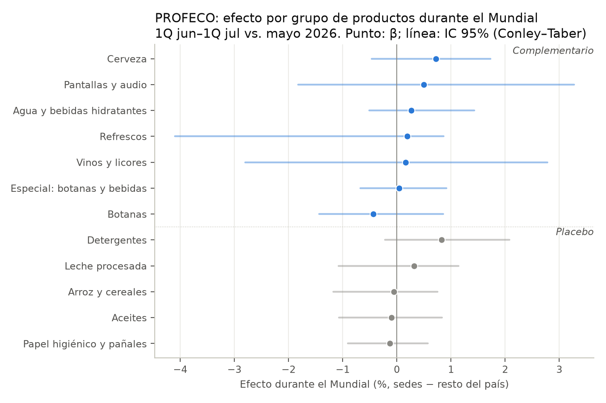
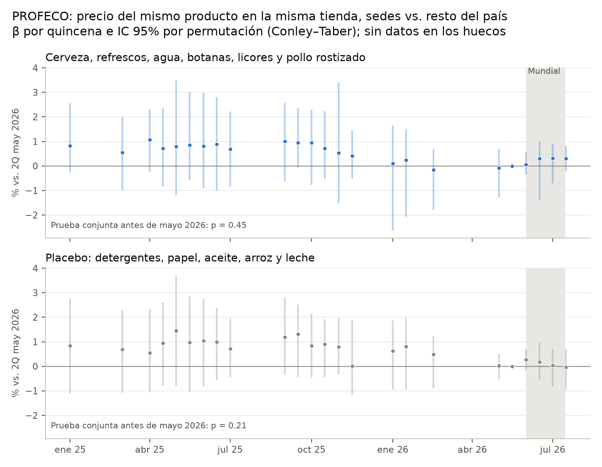
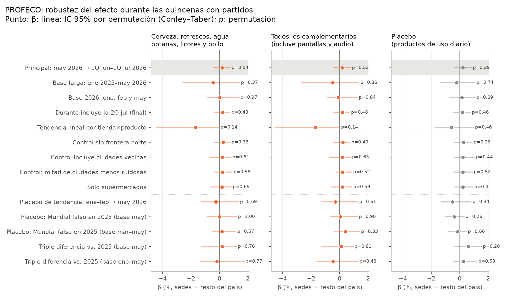

# Segunda fuente: precios de PROFECO por tienda y producto

Las cifras y gráficas salen de `code/05_profeco_limpieza.py` y `code/06_profeco_estimacion.py`. El análisis exploratorio de esta base está en [`profeco_eda.md`](profeco_eda.md).

## Respuesta corta

**Los productos de tienda que acompañan al futbol no subieron de precio en las sedes durante el Mundial.**

- Se compara el precio del mismo producto (marca y presentación) en la misma tienda entre mayo y las quincenas con partidos (1Q jun–1Q jul 2026). El grupo de comparación son las tiendas del resto del país.
- Cerveza, refrescos, agua, botanas, licores y pollo rostizado: **+0.19%** (IC 95%: −0.44 a +0.75; p = 0.54).
- Los productos placebo (detergentes, papel higiénico, aceite, arroz y leche) dan +0.22% (p = 0.39). Es decir, lo mismo que los complementarios.
- **Esto confirma con otra base lo que da el INPC para los bienes comerciables** (−0.57%, p = 0.67). El intervalo de PROFECO es angosto: descarta alzas de más de ~0.8%.
- **PROFECO no cubre restaurantes, bares ni transporte**, que es donde el INPC sí muestra un alza (+1.8% en servicios). Entonces no sirve para confirmar ese resultado. Lo que sí refuerza es la heterogeneidad: los servicios locales suben y los bienes que se venden en cadenas nacionales no.

## 1. La base

| | |
|---|---|
| **Fuente** | PROFECO, programa "Quién es Quién en los Precios" (QQP), datos abiertos |
| **Quién lo recaba** | Personal de PROFECO visita tiendas (supermercados, tiendas de conveniencia, departamentales, mercados) en las principales ciudades del país y registra el precio de cada producto |
| **Unidad** | Precio en pesos de un producto (marca y presentación) en una tienda, en un día |
| **Cobertura descargada** | 24 de los 31 archivos quincenales publicados de 2025 y 2026; ver la sección 5 |
| **Muestra de análisis** | 651 tiendas (276 en sedes: 223 CDMX, 26 Guadalajara, 27 Monterrey; 375 de control en 30 ciudades), 691 productos, 1.4 millones de precios tienda × producto × quincena |
| **Ligas** | [2025](https://www.datos.gob.mx/dataset/programa_quien_es_quien_precios_2025) y [2026](https://www.datos.gob.mx/dataset/programa_quien_es_quien_precios_2026) |

**Virtudes frente al INPC:**
- Es un precio en pesos de un producto específico, no un índice.
- Se observa la misma tienda en el tiempo, así que la composición no cambia.
- Trae coordenadas de cada tienda. Eso permite medir la distancia al estadio y al Fan Fest.
- Incluye un catálogo "Especial" de 2026 con botanas para ver partidos y artículos de futbol (playera oficial, balón).

**Limitaciones:**
- Solo cubre bienes de tienda; no hay servicios.
- En Guadalajara y Monterrey hay pocas tiendas (26 y 27).
- PROFECO no publicó la 1Q feb, marzo, abril ni de agosto en adelante de 2026. No hay quincenas entre febrero y mayo, ni después de julio.
- Casi todas las tiendas son de cadenas nacionales, que suelen fijar precios iguales en todo el país.

## 2. Diseño

- **Unidad:** par tienda × producto.
- **Cambio de cada par:** se calcula el cambio en 100·ln(precio) entre "antes" (1Q y 2Q mayo 2026) y "durante" (1Q jun, 2Q jun y 1Q jul 2026).
- **Contrafactual:** a cada par se le resta el cambio promedio del mismo producto en las tiendas de control.
- **Efecto:** el de una ciudad es el promedio de sus pares; β es el promedio simple de las 3 sedes. Equivale a una regresión con efectos fijos tienda×producto y producto×quincena.
- **Asignación de ciudades:** la zona se decide por municipio, con la ubicación mediana de sus tiendas.
  - **Sede:** municipio a menos de 40 km del estadio. Cubre la zona metropolitana: alcaldías de CDMX, Ecatepec, Naucalpan, Zapopan, Guadalupe, etc.
  - **Vecina, excluida del control:** entre 40 y 100 km de un estadio (Toluca, Cuernavaca, Pachuca, Tlaxcala, Saltillo). Pudo recibir aficionados.
  - **Control:** más de 100 km de cualquier estadio.
- **Inferencia (Conley–Taber):**
  - A cada ciudad de control se le calcula un "efecto" con el mismo procedimiento, dejándola fuera del contrafactual.
  - El p-valor y el IC 95% salen de la distribución del promedio de 3 ciudades de control (C(29,3) = 3,654 tripletas).
  - Solo entran ciudades con al menos 30 pares.

## 3. Resultados

| Conjunto | β durante (%) | IC 95% | p | CDMX | GDL | MTY |
|---|---|---|---|---|---|---|
| Bebidas, botanas y comida | 0.19 | −0.44 a 0.75 | 0.54 | 0.41 | −0.02 | 0.19 |
| Todos los complementarios | 0.19 | −0.45 a 0.77 | 0.53 | 0.39 | −0.33 | 0.51 |
| Pantallas y audio | 0.50 | −1.97 a 2.58 | 0.70 | 0.05 | −3.02 | 4.46 |
| Placebo | 0.22 | −0.34 a 0.83 | 0.39 | 0.15 | −0.10 | 0.62 |

Tablas: [`profeco_did_principal.csv`](../output/tables/profeco_did_principal.csv) y [`profeco_did_por_grupo.csv`](../output/tables/profeco_did_por_grupo.csv).

- **Por grupo:**
  - El más alto es cerveza: +0.72%, IC −0.46 a 1.73, p = 0.22.
  - Los demás complementarios están entre −0.4% y +0.5%.
  - Ninguno se distingue de los placebos.
- **Después (2Q jul, con la final):** complementarios +0.21% (p = 0.53).
- **Regresión de panel equivalente**, con peso por par (domina CDMX): β = 0.38%.
  - El error agrupado por ciudad da p = 0.0005, pero con 3 ciudades tratadas ese error no es confiable (Conley y Taber, 2011). Es el mismo problema que con el INPC.
  - [`profeco_regresion_panel.csv`](../output/tables/profeco_regresion_panel.csv)

## 4. Robustez y heterogeneidad

**Estudio de evento:**
- No hay tendencias previas: la prueba conjunta da p = 0.45 en bebidas y botanas y p = 0.21 en placebos.
- En 2025 los precios de las sedes estaban ~0.8% más altos que en mayo 2026, frente al control. La diferencia cae casi toda en enero 2026, igual en los placebos, así que es un cambio común a todos los bienes y no tiene que ver con el Mundial (ver `profeco_eda.md`, sección 7). Por eso el diseño principal compara contra mayo 2026, el mes previo.

Son las mismas pruebas que `07_robustez.py` hace con el INPC (ver `robustez.md`), más dos propias de PROFECO: incluir las ciudades vecinas y usar solo supermercados.

| Prueba (bebidas, botanas y comida) | β (%) | IC 95% | p |
|---|---|---|---|
| **Principal: may → 1Q jun–1Q jul 2026** | **0.19** | −0.44 a 0.75 | 0.54 |
| Base larga: ene 2025–may 2026 | −0.45 | −2.62 a 1.42 | 0.37 |
| Base 2026: ene, feb y may | 0.02 | −0.85 a 1.37 | 0.97 |
| "Durante" incluye la 2Q jul (final) | 0.23 | −0.37 a 0.74 | 0.43 |
| Tendencia lineal por tienda×producto | −1.67 | −4.45 a −0.02 | 0.14 |
| Control sin frontera norte | 0.26 | −0.35 a 0.75 | 0.36 |
| Control incluye ciudades vecinas | 0.20 | −0.68 a 0.81 | 0.61 |
| Control: mitad de ciudades menos ruidosas | 0.20 | −0.33 a 0.90 | 0.58 |
| Solo supermercados | 0.17 | −0.61 a 0.84 | 0.65 |
| Placebo de tendencia: ene–feb → may 2026 | −0.24 | −1.26 a 1.35 | 0.69 |
| Placebo: Mundial falso en 2025 (base may) | 0.00 | −0.84 a 1.21 | 1.00 |
| Placebo: Mundial falso en 2025 (base mar–may) | 0.18 | −0.50 a 1.15 | 0.57 |
| Triple diferencia vs. 2025 (base may) | 0.19 | −1.27 a 1.20 | 0.76 |
| Triple diferencia vs. 2025 (base ene–may) | −0.18 | −1.29 a 1.73 | 0.77 |

- **Ninguna prueba da un alza significativa.**
- **La base larga y la tendencia lineal dan negativo.** Las dos comparan contra 2025 y arrastran el escalón de enero 2026.
  - La tendencia lineal además lo proyecta hacia adelante. Por eso su IC apenas toca el cero, aunque la permutación da p = 0.14.
  - Los placebos se mueven en la misma dirección (−0.21 y −0.56). Eso confirma que es algo común a todos los bienes de las sedes y no un efecto del Mundial.
- **En el INPC la tendencia lineal no tiene ese problema.** Se ajusta a índices de ciudad, que se mueven de forma más suave que el precio de un producto en una tienda.

Tabla completa (también complementarios y placebo): [`profeco_robustez.csv`](../output/tables/profeco_robustez.csv).

**Heterogeneidad por cercanía:**
- **Pregunta:** dentro de cada sede, ¿subieron más los precios en las tiendas a menos de 5 km del estadio o del Fan Fest, donde se concentran los aficionados?
- **Respuesta: no.**
  - Bebidas y botanas: cerca menos lejos = −0.37% (p = 0.50).
  - Solo cerca del Fan Fest, todos los complementarios: +0.75% (p = 0.18).
  - Placebos: −0.36% (p = 0.25).
- **Cómo se calcula el p-valor:** se reasigna al azar la etiqueta "cerca" entre tiendas de la misma sede (4,999 permutaciones).
- **Limitación:** en Monterrey solo hay 2–3 tiendas cerca, y en Guadalajara solo 2 cerca del estadio.
- Tabla: [`profeco_heterogeneidad_distancia.csv`](../output/tables/profeco_heterogeneidad_distancia.csv)

**Cómo leerlo:** las cadenas nacionales (Walmart, Soriana, Oxxo, Chedraui) fijan precios casi iguales en todo el país (DellaVigna y Gentzkow, 2019, encuentran lo mismo en EE. UU.). Un choque de demanda local de unas semanas no les mueve el precio de lista. Los servicios locales (restaurantes, bares, estacionamiento) sí pueden ajustar. Esto apoya la heterogeneidad del INPC: servicios +1.8%, bienes comerciables sin cambio.

## 5. Cómo se descargaron y limpiaron los datos

**Descarga:**
- Los CSV completos (~200 MB cada uno, ~5 GB los 31) **no se suben al repositorio**. Viven en `data/raw/profeco/`, que está en `.gitignore`.
- Para reproducir, hay que bajarlos a mano desde las páginas de datos abiertos (ligas en la sección 1) con el botón "Descargar" de cada quincena. El servidor rechaza descargas automáticas (curl o scripts).
- La lista de archivos esperados está en `config.PROFECO_ARCHIVOS`.
- **Faltan 7 de 31:** 01-2025_02, 02-2025_01, 02-2025_02, 03-2025_02, 07-2025_02, 08-2025_01 y 08-2025_02. El servidor cortaba esas descargas a la mitad. Ninguna entra en el diseño principal; solo darían más quincenas al estudio de evento.
- `05_profeco_limpieza.py` funciona con los archivos que encuentre y avisa cuáles faltan.

**Limpieza (`05_profeco_limpieza.py`):**
- **Acentos:** cada archivo los escribe distinto: sin acento ("Basicos"), con "?" en su lugar ("Bal?n", junio 2026) o con acento ("Básicos", julio 2026). Productos y tiendas se identifican con una clave que quita acentos, signos, vocales y la letra n, para que las tres versiones coincidan.
- **Columnas extra:** los archivos de junio 2026 traen columnas que los demás no tienen (folio, claves de producto y marca). No se usan, para tratar igual a todos los archivos.
- **Archivo cortado:** el de la 2Q nov 2025 viene incompleto desde la fuente. Llega solo al día 28, con la mitad de las tiendas y una línea malformada.
- **Catálogos:** se dejan fuera "Pacic", con precios pactados con el gobierno, y "Mercados".
- **Atípicos:** se eliminan precios más de 3 veces arriba o abajo de la mediana del producto (102 de 2.4 millones).
- **Coordenadas:** las de una tienda a más de 30 km del centro de su municipio se ignoran.
- **Panel:** el precio de cada tienda × producto × quincena es el promedio de sus registros.
