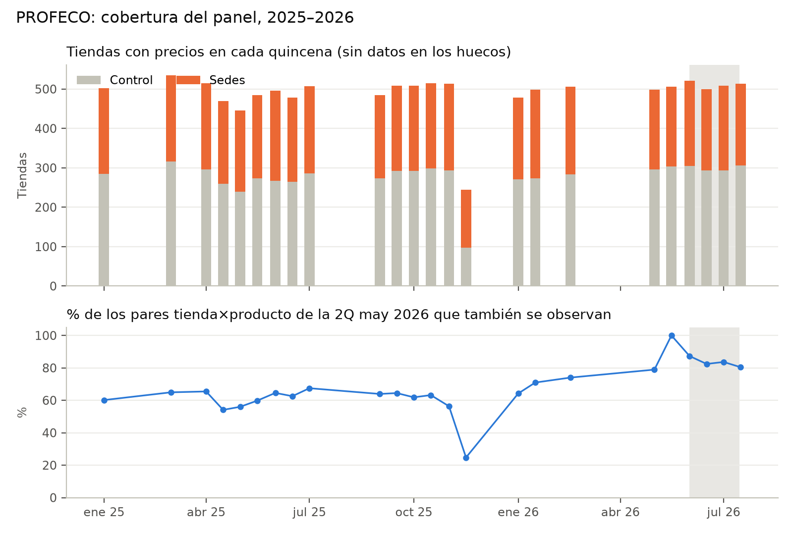
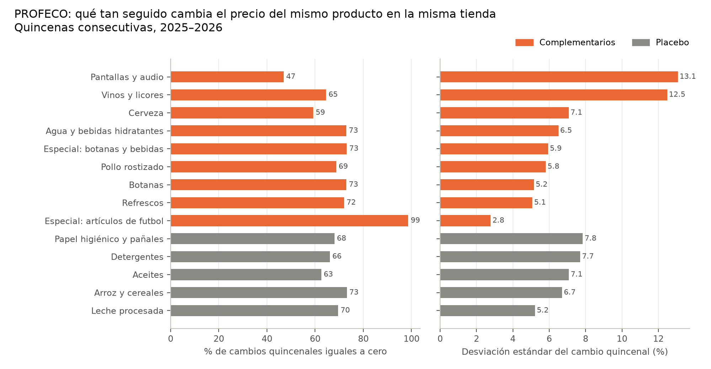
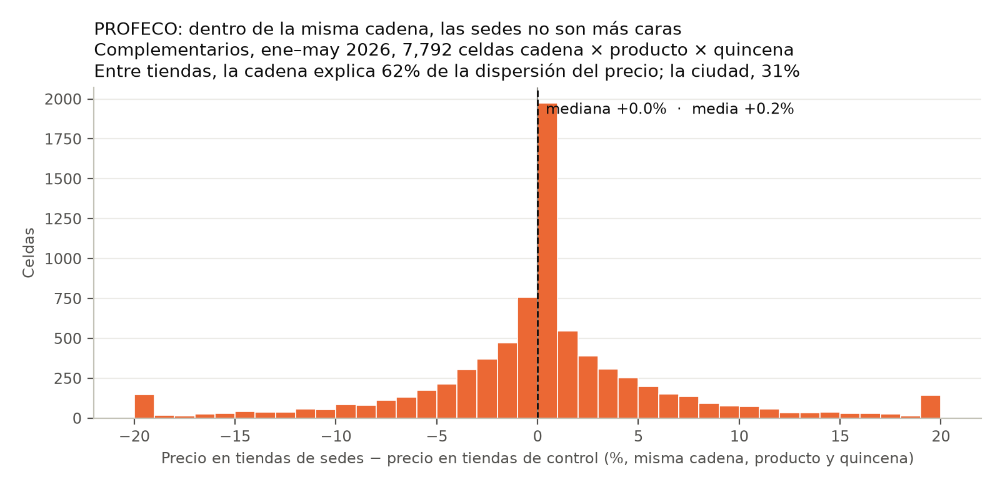
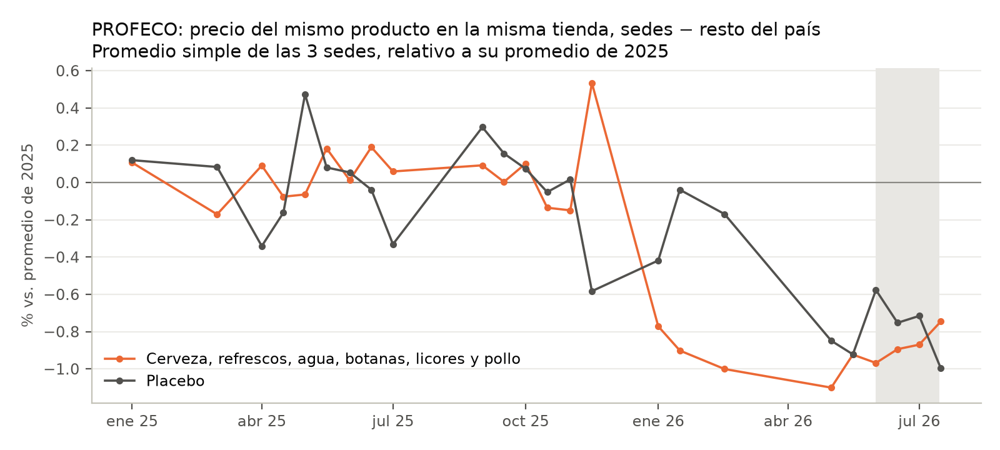

# Análisis exploratorio de la base de PROFECO

Es el mismo análisis que [`eda.md`](eda.md) hace con el INPC, más una sección que solo PROFECO permite: si las cadenas cobran lo mismo en todo el país (sección 4). Las cifras y gráficas salen de `code/05b_profeco_eda.py`:

```bash
.venv/bin/python code/05b_profeco_eda.py   # después de 05_profeco_limpieza.py
```

## Respuesta corta

- **Sí sirve para la métrica**, pero solo para los **bienes** que se venden en tiendas: cerveza, refrescos, agua, botanas, licores, pollo rostizado y pantallas. No trae restaurantes, bares ni transporte.
- **Lo que agrega frente al INPC:**
  - el precio en pesos del mismo producto en la misma tienda;
  - las coordenadas de cada tienda;
  - la posibilidad de comparar la misma cadena entre ciudades.
- **Lo que tiene en contra:**
  - menos ciudades de control (30);
  - pocas tiendas en Guadalajara y Monterrey (26 y 27);
  - huecos en 2026: no hay 1Q feb, marzo, abril ni de agosto en adelante;
  - solo dos años de historia.
- **El hallazgo principal:** dentro de la misma cadena, producto y quincena, las sedes no son más caras que el resto del país. La diferencia mediana es 0.0%. Las cadenas fijan sus precios por región, no por ciudad. Por eso un choque de demanda local no se ve en estos precios.

## 1. Lo que pide la consigna, punto por punto

| Requisito | ¿Cumple? | Detalle |
|---|---|---|
| Métrica: precios de complementarios, sin hospedaje | Solo bienes | 9 grupos de complementarios y 5 de placebo. No hay servicios. |
| (b) Quién recaba los datos | Sí | PROFECO, programa "Quién es Quién en los Precios". |
| (b) Periodo | Parcial | 24 quincenas de ene 2025 a jul 2026, con huecos (sección 2). |
| (b) Unidad de observación | Sí | Precio de un producto (marca y presentación) en una tienda, por quincena. |
| (b) Población | Parcial | Tiendas que visita PROFECO en las principales ciudades. No es una muestra representativa del consumo. |
| (b) Virtudes y limitaciones | Sí | Secciones 2 a 7. |
| Grupo tratado y de control | Sí | 276 tiendas en sedes (223 CDMX, 26 GDL, 27 MTY) y 375 en 30 ciudades de control. |
| Periodos antes, durante y después | Sí | Antes: 2025, ene–feb y may 2026. Durante: 1Q jun–1Q jul. Después: 2Q jul. |
| Material para robustez | Sí | Año 2025 como placebo, productos placebo, ciudades vecinas y fronterizas. |
| Material para heterogeneidad | Sí | Por grupo de producto, por tipo de tienda y por distancia al estadio o al Fan Fest. |

## 2. Cobertura



- **Tiendas:** cada quincena hay ~480–530, de las cuales ~205–230 están en sedes.
- **Productos:** ~480 en 2025 y ~570 en 2026.
  - El catálogo "Especial" (botanas para ver partidos y artículos de futbol) aparece en la 2Q feb 2026.
  - Tiene ~4,000 pares en junio–julio y baja a ~1,260 en la 2Q jul.
- **Continuidad del panel:** de los pares tienda×producto observados en la 2Q may 2026, se vuelven a ver 87% en la 1Q jun, 82–84% en el resto del torneo y 80% en la 2Q jul. En 2025 se observan 54–67%.
- **Huecos:**
  - Entre los 31 archivos publicados faltan 7 de 2025, que el servidor cortaba a la mitad: ene 2Q, feb, mar 2Q, jul 2Q y ago.
  - PROFECO no publicó la 1Q feb, marzo, abril ni de agosto en adelante de 2026.
  - El archivo de la 2Q nov 2025 viene cortado desde la fuente: tiene la mitad de las tiendas.
- Tabla: [`profeco_eda_cobertura.csv`](../output/tables/profeco_eda_cobertura.csv)

## 3. Cómo se mueven los precios



- **Rigidez:** entre dos quincenas seguidas, el precio del mismo producto en la misma tienda no cambia en 60–73% de los casos.
  - Refrescos, botanas y agua: ~72%.
  - Cerveza: 59%.
  - Pantallas: 47%, por las promociones.
  - Artículos de futbol: 99%.
- **Tamaño de los cambios:** la desviación estándar es de 5–7% en bebidas, botanas y placebos, y de 12–13% en licores y pantallas. Esos dos grupos son los más ruidosos.
- **Las tiendas de las sedes cambian de precio un poco menos que las del control,** 3–6 puntos más de quincenas sin cambio. Por ejemplo, cerveza: 62% contra 57%.
- **Los placebos se mueven parecido a los complementarios.** Sirven para calibrar el ruido.
- Tabla: [`profeco_eda_cambios.csv`](../output/tables/profeco_eda_cambios.csv)

## 4. Precios uniformes: el mecanismo



**Pregunta:** si una cadena cobra lo mismo en todas sus tiendas, un aumento de demanda en una sola ciudad no debería mover su precio. ¿Pasa eso?

**Respuesta: sí en lo que importa, aunque los precios no son idénticos.**
- **La cadena explica 62% de la dispersión del precio entre tiendas; la ciudad, 31%.** Es la misma marca y presentación en la misma quincena. En placebos: 59% contra 20%.
- **Los precios no son idénticos en todo el país.**
  - Solo 21% de las combinaciones cadena × producto × quincena tienen el mismo precio (±1%) en todas las ciudades.
  - La diferencia típica entre la tienda más cara y la más barata de una cadena es 10%.
  - Las cadenas grandes (Soriana, Walmart, Bodega Aurrera, Oxxo, Chedraui) fijan precios por región.
- **Pero las sedes no son más caras dentro de la misma cadena.**
  - En las 7,792 combinaciones con tiendas en sedes y en control, la diferencia sede − control tiene **mediana 0.0% y media +0.16%**.
  - En 35% de los casos los precios son iguales (±1%), y en 72% difieren menos de 5%.
- **Implicación:** el precio de un refresco o una cerveza lo decide la cadena para una región amplia, no la tienda según su demanda local. Eso explica por qué los bienes no responden al Mundial, mientras que restaurantes, bares y estacionamientos, que fijan su precio localmente, sí.
- Tablas:
  - [`profeco_eda_precios_uniformes.csv`](../output/tables/profeco_eda_precios_uniformes.csv)
  - [`profeco_eda_precios_uniformes_cadena.csv`](../output/tables/profeco_eda_precios_uniformes_cadena.csv)

## 5. Las sedes frente a las demás ciudades

**Composición:** las tiendas de las sedes son distintas a las del control.

| | Sedes | Control |
|---|---|---|
| Supermercados | 74% | 43% |
| Tiendas de electrodomésticos | 8% | 25% |
| Departamentales | 6% | 12% |
| Conveniencia | 5% | 12% |

- Walmart Express es 10% de las tiendas de las sedes y casi no aparece en el control.
- Por eso una de las pruebas de robustez usa solo supermercados (`profeco.md`).
- Tabla: [`profeco_eda_composicion.csv`](../output/tables/profeco_eda_composicion.csv)

**Volatilidad:**
- A diferencia del INPC, donde las sedes eran de las ciudades menos ruidosas, aquí quedan a media tabla: Monterrey en el percentil 28, CDMX en el 38 y Guadalajara en el 53 (de 32 ciudades).
- La permutación con PROFECO no es especialmente conservadora.
- Tabla: [`profeco_eda_volatilidad_ciudades.csv`](../output/tables/profeco_eda_volatilidad_ciudades.csv)

## 6. Placebo por año

Es la misma comparación (mayo → 1Q jun–1Q jul, sedes − resto) en los dos años disponibles:

| Conjunto | 2025 (sin Mundial) | 2026 (Mundial) |
|---|---|---|
| Bebidas, botanas y comida | 0.00 | +0.19 |
| Todos los complementarios | +0.06 | +0.19 |
| Placebo | −0.39 | +0.22 |

- **En los bienes no hay estacionalidad propia de las sedes en junio–julio.** El INPC sí la tiene en servicios.
- **2026 se parece a 2025.**
- Tabla: [`profeco_eda_placebo_anios.csv`](../output/tables/profeco_eda_placebo_anios.csv)

## 7. Brecha sedes − resto del país



- **Cómo se calcula:** con el mismo estimador que la estimación principal. Se usa el cambio del mismo par tienda×producto frente a su promedio de 2025, y cada sede pesa igual.
- **2025:** la brecha está plana, alrededor de 0.
- **Enero 2026:** baja ~1 punto en bebidas y botanas.
  - Coincide con el aumento del IEPS a refrescos, que en el INPC salta en todas las ciudades.
  - Un impuesto por litro sube menos, en porcentaje, donde el precio es más alto; esto es una posible explicación, no está comprobada.
  - Los placebos bajan algo parecido hacia mayo.
- **Durante el Mundial:** la brecha no cambia.
- **Consecuencia para la estimación:** comparar contra todo 2025 (base larga) mete ese escalón de enero y da un "efecto" negativo, también en los placebos. Por eso el diseño principal de PROFECO compara contra mayo 2026.
- **Ojo:** si la brecha se calcula con promedios simples por producto, sale una caída en junio–julio. Es un artefacto. Cada modelo de pantalla cuenta como un producto distinto y sus precios son muy volátiles por las promociones, así que las pantallas pesan de más. Por eso la gráfica usa el estimador.
- Tabla: [`profeco_eda_brecha.csv`](../output/tables/profeco_eda_brecha.csv)
