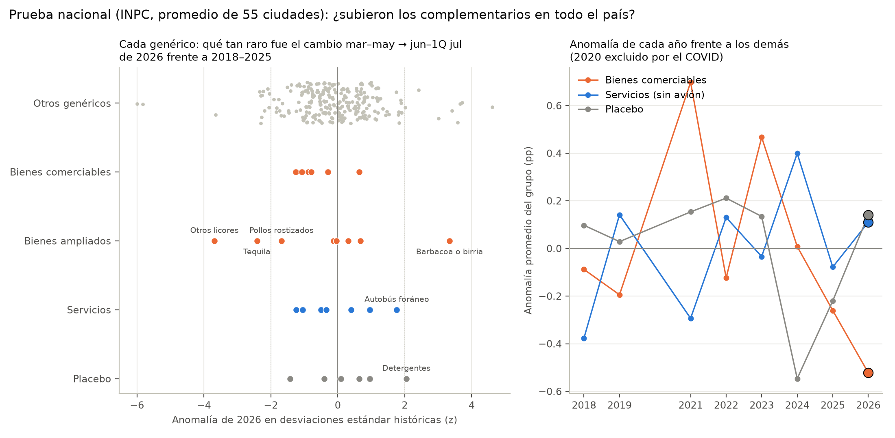

# Prueba nacional: ¿subieron los complementarios en todo el país?

Las cifras y la gráfica salen de `code/08_prueba_nacional.py` (corre en ~3 s):

```bash
.venv/bin/python code/08_prueba_nacional.py
```

## Por qué hace falta

La diferencia en diferencias compara las sedes contra el resto del país. Si el Mundial subió la demanda de cerveza, botanas o pantallas **en todas las ciudades** (mucha gente vio los partidos de México en casa), ese efecto se reparte entre todas las ciudades y la diferencia en diferencias no lo ve.

Entonces "no subieron en las sedes frente al resto" no basta para decir "no subieron". Esta prueba busca ese efecto nacional.

## Diseño

**Sin grupo de control geográfico.** El contrafactual es lo que normalmente pasa en esos meses.

**INPC, todos los genéricos, promedio simple de las 55 ciudades:**
1. Para cada genérico y año (2018–2026), se calcula el cambio de precio de mar–may a 1Q jun–1Q jul.
2. Se resta la mediana del cambio de todos los genéricos de ese año, para quitar la inflación general del año.
3. **Anomalía de 2026:** el cambio de 2026 menos el promedio de los años de referencia (2018, 2019 y 2021–2025; 2020 queda fuera por el COVID).
   - **z** es la anomalía dividida entre la desviación estándar histórica del genérico. Mide qué tan raro fue 2026 para ese producto.
   - Entran 275 genéricos con al menos 5 años de referencia. Quedan fuera hoteles, paquetes turísticos y los genéricos nuevos de la canasta 2024.
4. **Inferencia:**
   - **Contra genéricos al azar:** ¿la z promedio del grupo es más extrema que la de grupos del mismo tamaño tomados al azar (20,000 sorteos)?
   - **Contra otros años:** la misma estadística, fingiendo que el Mundial fue en cada uno de los otros 7 años.

**PROFECO, todas las tiendas del país:**
- Para cada par tienda×producto: el cambio de mayo a 1Q jun–1Q jul de 2026, menos el mismo cambio en 2025.
- Se comparan los productos complementarios contra los placebo, permutando las etiquetas entre productos (20,000 permutaciones).

## Resultados



**INPC, anomalía nacional de 2026 por grupo:**

| Grupo | Genéricos | Anomalía promedio (pp) | z promedio | p (genéricos al azar) | Lugar de 2026 entre 8 años |
|---|---|---|---|---|---|
| Bienes comerciables: cerveza, refrescos, botanas, TV, deportivos | 6 | −0.52 | −0.61 | 0.22 | 5.º |
| Bienes ampliados: licores, agua, pollo, barbacoa, TV de paga, tenis | 8 | −0.72 | −0.45 | 0.30 | 4.º |
| Servicios sin transporte aéreo | 6 | +0.11 | +0.20 | 0.67 | 7.º |
| Servicios con transporte aéreo | 7 | −1.87 | −0.00 | 0.99 | 8.º |
| Placebo | 6 | +0.14 | +0.32 | 0.52 | 4.º |

- El promedio de servicios con transporte aéreo lo domina el avión (−13.7 pp), que es muy volátil. Su z es apenas −1.25.

**Por genérico:**
- **Cerveza:** −0.28 pp (z = −0.30).
- **Refrescos:** −0.28 (z = −0.88).
- **Papas fritas:** −0.55 (z = −1.07).
- **Televisores:** −1.76 (z = −0.79).
- **Restaurantes:** −0.12 (z = −0.50).
- **Loncherías y fondas:** −0.07 (z = −0.34).

**PROFECO, cambio de 2026 menos cambio de 2025, todas las tiendas:**

| Conjunto | Productos | Frente a placebo (pp) | p |
|---|---|---|---|
| Bebidas, botanas y comida | 119 | −0.48 | 0.24 |
| Cerveza | 16 | −1.15 | 0.23 |
| Refrescos | 39 | −0.36 | 0.57 |
| Agua y bebidas hidratantes | 31 | +0.69 | 0.33 |
| Botanas | 22 | −0.33 | 0.67 |
| **Vinos y licores** | 10 | **−3.73** | **0.01** |
| Pantallas y audio | 15 | +0.15 | 0.88 |

Tablas:
- [`nacional_inpc_grupos.csv`](../output/tables/nacional_inpc_grupos.csv)
- [`nacional_inpc_genericos.csv`](../output/tables/nacional_inpc_genericos.csv)
- [`nacional_inpc_anios.csv`](../output/tables/nacional_inpc_anios.csv)
- [`nacional_profeco.csv`](../output/tables/nacional_profeco.csv)

## Cómo leerlo

1. **No hubo un alza nacional en los complementarios.**
   - Ningún grupo se sale de lo normal, y 2026 queda a media tabla entre los años.
   - Si acaso, los bienes bajaron un poco frente a su patrón de temporada (−0.5 pp). Es compatible con promociones del Mundial, aunque no es significativo.
   - Con esto se cierra el hueco de la diferencia en diferencias: los bienes no subieron ni en las sedes ni en el país.
2. **Los licores sí bajaron, y lo dicen las dos bases.**
   - En el INPC, "otros licores" (whisky, brandy, ron) cae −3.2 pp (z = −3.7). Es el 5.º cambio más raro de 275 genéricos. Tequila cae −2.5 pp (z = −2.4).
   - En PROFECO, con datos independientes, vinos y licores caen −3.7 pp frente a los placebos (p = 0.01).
   - Una explicación posible son las promociones de marcas y tiendas durante el torneo.
   - **Hay que tratarlo como hallazgo exploratorio:** se revisaron muchos genéricos y 9% tuvo |z| > 2 en 2026. Lo que lo hace creíble es que dos fuentes distintas coinciden.
3. **Los servicios no se movieron a nivel nacional,** sin contar el avión. Entonces el alza en servicios de la diferencia en diferencias (+1.8%, o +2.8% en la triple diferencia) es un efecto **local**, de las sedes. No es un aumento de temporada en todo el país.

## Limitaciones

- **Sin grupo de control:** el supuesto es que, sin Mundial, 2026 se habría parecido a los años anteriores. Cualquier otro choque nacional de junio de 2026 se confunde con el torneo.
- **Promedio simple de ciudades:** no usa los ponderadores del INPC, que siguen pendientes. CDMX pesa lo mismo que una ciudad pequeña.
- **PROFECO** solo tiene 2025 como año de comparación.
- **Muchos genéricos y grupos revisados:** un resultado aislado con p ≈ 0.05 podría salir por azar.
