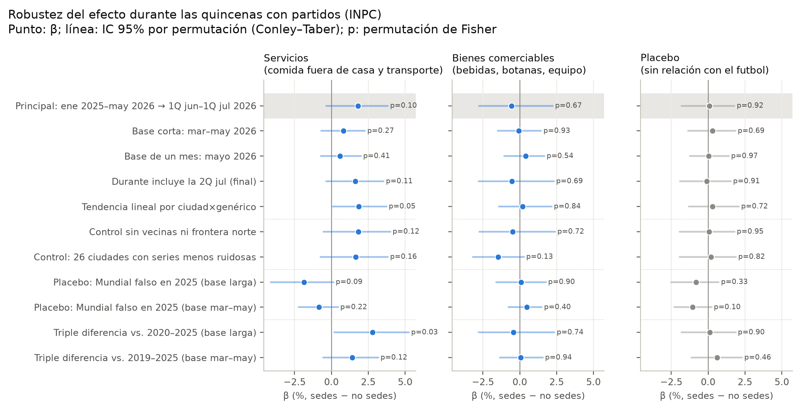

# Robustez de la estimación con el INPC

Las cifras y la gráfica salen de `code/07_robustez.py` (corre en ~1 s):

```bash
.venv/bin/python code/07_robustez.py
```

## Respuesta corta

- **Los servicios (comida fuera de casa y transporte) suben en las sedes en todas las variantes del diseño.** Las estimaciones van de +0.6% a +2.8%. El signo solo se invierte en los placebos, que es lo esperado.
- **Lo que no es robusto es la significancia.** La mayoría de los p-valores está entre 0.05 y 0.4.
- **La prueba que mejor responde a la amenaza principal es la triple diferencia** contra 2020–2025: **+2.8% (IC 95%: 0.2 a 5.3; p = 0.03)**, con el placebo en +0.1% (p = 0.90).
  - La amenaza es la estacionalidad y la tendencia propias de las sedes: en un año sin Mundial, los servicios de las sedes se quedan atrás en junio–julio.
- **Bienes comerciables y placebos:** ninguna variante da un efecto distinto de cero.



## Qué cambia cada prueba

Todas usan el mismo estimador y la misma inferencia que `04_estimacion.py`:
- El estimador es la diferencia en diferencias de promedios por ciudad. Es igual a β de la regresión con efectos fijos, porque el panel está balanceado.
- La inferencia es la permutación de Fisher y el intervalo de Conley–Taber.

El script verifica que la fila "Principal" reproduzca `tab_did_principal.csv`. Cada prueba cambia una sola cosa.

| Prueba | Qué cambia | Por qué |
|---|---|---|
| Base corta: mar–may 2026 | Periodo de comparación de 3 meses en lugar de 17 | Menos expuesta a tendencias de largo plazo |
| Base de un mes: mayo 2026 | Solo el mes previo | Mismo diseño que PROFECO |
| Durante incluye la 2Q jul | Agrega la quincena de la final (19 jul) | La consigna ubica el torneo hasta el 19 de julio |
| Tendencia lineal por ciudad×genérico | Cada serie se compara contra su propia recta de ene 2025–may 2026, extrapolada | Equivale a agregar λ_cj·t a la regresión |
| Control sin vecinas ni frontera norte | Quita Toluca, Cuernavaca, Pachuca, Tlaxcala, Saltillo, Tepatitlán, Atlacomulco y 5 ciudades fronterizas (quedan 43 ciudades) | Las vecinas pudieron recibir aficionados; la frontera tiene IVA de 8% y salario mínimo propio |
| Control: 26 ciudades menos ruidosas | Solo la mitad de ciudades de control con series más estables | Las sedes tienen series muy estables, así que la permutación con todas las ciudades es conservadora (ver `docs/eda.md`) |
| Placebo: Mundial falso en 2025 | Mismo diseño, un año antes | Si da un "efecto", el diseño capta algo que no es el Mundial |
| Triple diferencia | Cambio de 2026 menos el cambio promedio de los mismos meses en años anteriores | Quita la estacionalidad propia de las sedes y, con la base larga, su tendencia |

## Resultados: servicios

| Prueba | β (%) | IC 95% | p |
|---|---|---|---|
| **Principal** | **1.80** | −0.35 a 3.83 | 0.10 |
| Base corta: mar–may 2026 | 0.82 | −0.70 a 2.28 | 0.27 |
| Base de un mes: mayo 2026 | 0.58 | −0.71 a 2.00 | 0.41 |
| Durante incluye la 2Q jul | 1.62 | −0.34 a 3.55 | 0.11 |
| Tendencia lineal por ciudad×genérico | 1.85 | 0.08 a 3.74 | 0.05 |
| Control sin vecinas ni frontera norte | 1.83 | −0.53 a 4.00 | 0.12 |
| Control: 26 ciudades menos ruidosas | 1.66 | −0.73 a 3.83 | 0.16 |
| Placebo: Mundial falso en 2025 (base larga) | −1.87 | −4.12 a 0.14 | 0.09 |
| Placebo: Mundial falso en 2025 (base mar–may) | −0.84 | −2.24 a 0.45 | 0.22 |
| **Triple diferencia vs. 2020–2025 (base larga)** | **2.78** | 0.19 a 5.26 | **0.03** |
| Triple diferencia vs. 2019–2025 (base mar–may) | 1.42 | −0.56 a 3.18 | 0.12 |

Sin transporte aéreo, que es casi puro ruido:
- Principal: 1.10% (p = 0.06).
- Triple diferencia con base larga: 1.49% (p = 0.05).

Bienes comerciables:
- Van de −1.47% a +0.49%; ningún p-valor está por debajo de 0.13.

Placebo:
- Va de −1.05% a +0.60%.
- En la triple diferencia con base larga da 0.11% (p = 0.90).

Tabla completa: [`tab_robustez.csv`](../output/tables/tab_robustez.csv).

## Cómo leerlo

1. **Por qué la base corta da menos.** El estudio de evento muestra que los servicios de las sedes suben un escalón desde marzo 2026, antes del torneo (estacionamiento, autobús foráneo, centros nocturnos).
   - Con base mar–may, ese escalón ya está en la comparación. Lo que queda es solo el salto adicional durante los partidos.
   - Con la base larga se mide el efecto total, incluida la anticipación.
   - La diferencia entre 1.8% y 0.8% es, en buena parte, ese escalón previo.
2. **El placebo de 2025 da negativo.** No significa que el diseño falle. En un año normal, los servicios de las sedes se quedan atrás en junio–julio: la temporada de verano sube más los precios en destinos turísticos que en las grandes ciudades. Además, los servicios de las sedes llevan años subiendo menos que en el resto (`docs/eda.md`, secciones 5 y 6).
   - Por eso la diferencia en diferencias simple **subestima** el efecto del Mundial.
   - La triple diferencia lo corrige: compara 2026 contra lo que pasa normalmente en esos meses.
3. **Cuál reportar.**
   - **Resultado principal:** la estimación principal (+1.8%).
   - **Robustez del reporte:** la triple diferencia con base larga (+2.8%, p = 0.03).
     - Es la prueba que responde a la amenaza que encontró el análisis exploratorio.
     - Su placebo da cero.
   - **Advertencia:** con 3 sedes, cualquier estimación individual tiene p-valores cercanos a 0.1. La conclusión sólida es el patrón: los servicios suben en todas las variantes, y los bienes y los placebos no.
4. **Coincide con PROFECO.** El precio de la misma cerveza o refresco en la misma tienda tampoco sube en las sedes: +0.19%, IC −0.44 a +0.75 (`docs/profeco.md`).
